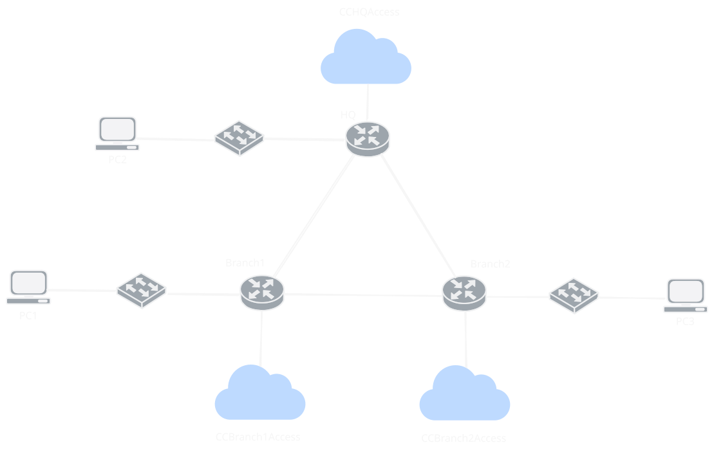
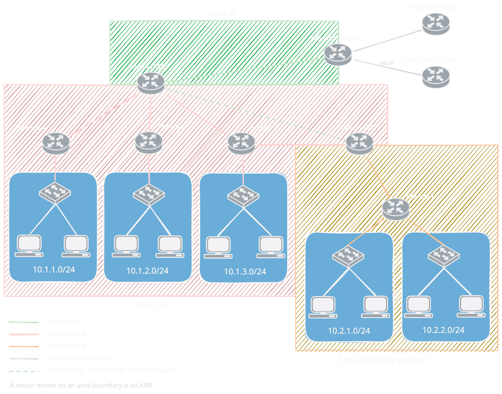
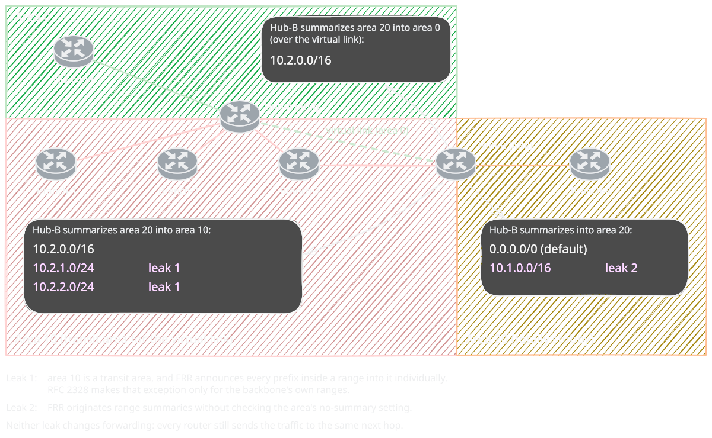

# LLMnetopsLab — Evaluating LLM Agents on Network Troubleshooting

Master's research project studying how well an autonomous LLM coding agent (Claude Code) can troubleshoot misconfigured networks. Each lab is a live GNS3 topology seeded with intentional faults. Claude Code is given SSH access to the devices and a prompt describing the intended design, then left to diagnose and repair the network unattended. Every run is captured (transcript + post-run config check) so fix rates, reasoning behaviour, tool usage and cost can be compared across runs and across lab difficulty.

The project has two lab versions of increasing complexity:

| | **v1** | **v2** |
|---|---|---|
| Origin | VyOS translation of Cisco Packet Tracer Activity 11.6.3 (CCNA OSPF troubleshooting) | Original design |
| Devices | 3 routers, 3 hosts | 9 routers, 10 hosts (19 devices) |
| Platforms | VyOS, VPCS | VyOS, MikroTik RouterOS 7.23.7, Alpine Linux 3.24.2 |
| Routing | Single-area OSPF, default route from HQ | Multi-area OSPF (areas 0/10/20), ABRs, virtual link, MD5 auth on area 0, totally stubby area, inter-area summarization, ASBR with eBGP to dual ISPs, NAT, guest LAN firewall |
| Faults | 6 known faults (3 on HQ, 3 on Branch2) | 12 faults across all three platforms, not disclosed to the agent ("may be anywhere in the lab") |
| Status | Complete — 50 runs captured and analyzed | 50 automated runs (Claude Opus 4.6) captured, validated and analyzed; comparison with v1 in progress |

## Repository Layout

```
v1/                          # Single-area OSPF lab (CCNA 11.6.3 translation)
├── claude-prompt/CLAUDE.md  # Prompt given to Claude Code
├── configs/
│   ├── VyOS/{broken,corrected,CCAccess}/
│   ├── cisco/{broken,corrected}/   # Original IOS scripts for comparison
│   └── vpcs/
├── gns3/                    # Wiring guide + topology diagram
├── scripts/                 # push / verify / parse tooling
├── notebooks/               # Result visualizations
├── figures/                 # PNG exports of the notebook's figures
└── results/                 # 50 runs: verify JSON + Claude Code transcripts
v2/                          # Multi-area, multi-vendor OSPF WAN lab
├── claude-prompt/CLAUDE.md  # Prompt given to Claude Code
├── configs/
│   ├── VyOS/                # HQ-Edge, Hub-A, Hub-B, ISP-A, ISP-B (+ CCAccess/, broken/)
│   ├── Mikrotik/            # Branch-1 … Branch-4 (+ CCAccess/, broken/)
│   └── Alpine/              # 10 host scripts (+ CCAccess/, broken/)
├── gns3/                    # Wiring guide, topology and area 20 leak diagrams (SVG, Excalidraw sources)
├── scripts/
│   ├── connect_devices.py   # SSH reachability check for all 19 devices
│   ├── verify_lab.py        # Three-layer verifier (reachability, control plane, config intent)
│   ├── verifier/            # Verifier implementation
│   ├── fault_lab.py         # Inject / revert / test the 12 faults on the live lab
│   ├── faults/              # Fault catalog (answer key) and push helpers
│   ├── score_run.py         # Per-fault verdicts for an agent run (offline, from verifier output)
│   ├── run_agent.py         # One unattended agent run end to end (reset, break, agent, verify, score)
│   ├── run_batch.sh         # Runs run_agent.py back to back for a whole batch (WSL)
│   ├── validation/          # Run validity checks and transcript analysis
│   └── tests/               # Offline pytest suite (verifier, scorer, fault catalog)
├── notebooks/               # Result visualizations
├── figures/                 # PNG exports of the notebook's figures + area 20 leak diagram
└── results/
    ├── runs/opus/           # 50 agent runs: transcript, stream, baseline, verify, score, meta
    ├── verify/              # verify_lab.py runs and the correct/broken reference runs
    └── faults/              # fault_lab.py reference test runs (reference_single_faults{,_repeat}/fault_NN.json, summary.json)
```

---

## v1 — Single-Area OSPF (CCNA 11.6.3, VyOS Edition)

A VyOS translation of the Cisco IOS OSPF troubleshooting lab (Packet Tracer Activity 11.6.3), built in GNS3 with VyOS (`vyos-2026.02.12-0026-rolling-generic-amd64`) and VPCS. Three routers (HQ, Branch1, Branch2) run OSPF but contain **6 intentional errors**. Full wiring details are in [`v1/gns3/topology-notes.md`](v1/gns3/topology-notes.md).

### Topology



### Errors (answer key)

| Router | Error | Broken Value | Correct Value |
|--------|-------|-------------|---------------|
| HQ | Wrong IP on eth0 | 10.10.10.1/22 | 10.10.0.1/22 |
| HQ | Missing default-information originate | (absent) | `set protocols ospf default-information originate` |
| HQ | Wrong OSPF network prefix | 10.10.0.0/21 | 10.10.0.0/22 |
| Branch2 | eth2 disabled | `disable` present | Remove `disable` |
| Branch2 | Wrong passive-interface | eth2 | eth0 |
| Branch2 | Wrong OSPF LAN network | 10.10.4.0/22 | 10.10.6.0/23 |

### Interface Mapping (Cisco → VyOS)

| Cisco | VyOS | Role |
|-------|------|------|
| FastEthernet0/0 | eth0 | LAN |
| Serial0/0/0 | eth1 | WAN link 1 |
| Serial0/0/1 | eth2 | WAN link 2 |
| Loopback1 | lo | Simulated ISP (HQ only) |

### Quick Start

Run the scripts from inside `v1/` — they resolve `configs/` and `results/` relative to it.

1. Import VyOS and VPCS nodes into GNS3 and wire them per `v1/gns3/topology-notes.md`.
2. Apply `configs/VyOS/CCAccess/*.set` so each router is reachable over SSH on eth3 (192.168.122.0/24).
3. Load the broken configs: `python scripts/push_configs.py broken` (or paste `configs/VyOS/broken/*.set`). Use `corrected` to load the answer key.
4. Load `configs/vpcs/*.vpc` onto each VPCS node.
5. Start Claude Code with `claude-prompt/CLAUDE.md` as its prompt.

### Verification and Analysis

```bash
cd v1

# Compare live router configs to the answer key (auto-numbers results/verify/run_NNN.json)
python scripts/verify_configs.py
python scripts/verify_configs.py --run-number 5   # explicit run number
python scripts/verify_configs.py --no-file        # stdout only

# Aggregate verify results into fix-rate / per-error / per-router stats
python scripts/parse_results.py results/verify/

# Parse Claude Code transcripts for duration, token cost, tool usage and behavioural metrics
# (including whether agent-written Python scripts were used for diagnosis, fixing or verification)
python scripts/parse_transcripts.py results/cctranscripts/
```

Both parsers accept `--format json|table` and `--output <path>`.

**Token and cost correction (2026-10-08).** Claude Code writes one transcript entry per content block of a response (thinking, text, each tool call) and repeats the response's full usage on each one. `parse_transcripts.py` originally summed every entry, which roughly doubled tokens and cost. It now counts each API message once (verified against Claude Code's own session totals). `--count-duplicates` reproduces the original numbers, which are the ones in the v1 essay:

| | Original (essay) | Corrected |
|---|---|---|
| Total cost, 50 runs | $40.67 | $19.89 |
| Mean / median per run | $0.81 / $0.72 | $0.40 / $0.34 |
| Mean output tokens | 9,070 | 4,354 |

Durations, tool counts, behavioural metrics and all correctness results are unaffected.

To inspect a single run:

```bash
python results/cctranscripts/extract_bash.py results/cctranscripts/r037.jsonl --filter ospf
python results/cctranscripts/extract_messages.py results/cctranscripts/r037.jsonl   # --with-thinking for thinking blocks
```

### Results and Visualization

`results/` holds all 50 captured runs (`verify/run_001.json … run_050.json`, `cctranscripts/r001.jsonl … r050.jsonl`). Plots are generated in `notebooks/visualize_results.ipynb`; PNG exports are in `figures/`. The cost figures exist twice: `fig3_duration_cost` and `fig4_cost_breakdown` as published, and `*_corrected` versions with the token correction above:

```bash
pip install -r requirements-viz.txt
jupyter notebook notebooks/visualize_results.ipynb
```

---

## v2 — Multi-Area, Multi-Vendor OSPF WAN

v2 scales the experiment up to a realistic small-enterprise WAN to test whether the agent's performance holds when the problem is larger, spans multiple vendors' CLIs, and requires reasoning about multi-area OSPF behaviour rather than a single flat area. Unlike v1, the agent is not told how many faults exist or where they are. Full addressing and wiring are in [`v2/gns3/topology-notes.md`](v2/gns3/topology-notes.md).

### Topology



### Design

- **Area 0:** HQ-Edge ↔ Hub-A. HQ-Edge is the ASBR and originates the default route.
- **Area 10:** Hub-A ↔ Branch-1/2/3, plus Branch-3 ↔ Hub-B. Hub-A is an ABR.
- **Area 20:** Hub-B ↔ Branch-4. Hub-B is an ABR. Area 20 is totally stubby: Branch-4 should learn only area 20 routes plus a default injected by Hub-B (but see [the area 20 summarization leaks](#known-frr-behaviour-area-20-summarization-leaks)).
- **Authentication:** area 0 uses MD5, including the virtual link (which is logically an area 0 interface).
- **Virtual link:** Area 20 has no physical path to area 0, so Hub-A and Hub-B form a virtual link across transit area 10.
- **Summarization:** ABRs summarize area 10 LANs as 10.1.0.0/16 and area 20 LANs as 10.2.0.0/16.
- **Internet:** eBGP from HQ-Edge (AS 65000) to ISP-A (AS 65100) and ISP-B (AS 65200). Both ISPs send a default route plus their loopback; local preference makes ISP-A primary, and HQ-Edge advertises nothing back. Traffic is masqueraded out both uplinks. ISP loopbacks (8.8.8.8, 1.1.1.1) serve as test targets; 1.1.1.1 is always reached via ISP-B.
- **Guest LAN:** 10.2.2.0/24 on Branch-4 is internet-only, enforced by a stateful forward-chain filter on Branch-4.
- **Management:** every device has an out-of-band interface on 192.168.122.0/24 (configs in each platform's `CCAccess/` folder) that is never part of OSPF.

### Known FRR Behaviour: Area 20 Summarization Leaks



Even in the correct lab, FRR on Hub-B advertises two sets of routes that the design says should not appear:

- **Leak 1, area 20 /24s in area 10.** Hub-B announces 10.2.1.0/24 and 10.2.2.0/24 into area 10 next to the 10.2.0.0/16 summary. Area 10 is the transit area for the virtual link, and FRR announces every prefix inside a range individually into a transit area. RFC 2328 makes that exception only for the backbone's own ranges.
- **Leak 2, 10.1.0.0/16 in area 20.** Hub-B originates the area 10 summary into area 20 alongside the default, although area 20 is totally stubby. FRR originates range summaries without checking the area's `no-summary` setting.

Neither leak changes forwarding: every router still sends the traffic to the same next hop. No configuration within the design removes them, so the verifier treats them as part of the correct lab, and they are not one of the 12 faults. They matter for the experiment because the agent finds them while verifying its fixes: chasing them accounts for most of the workaround attempts (Hub-B prefix-lists and filter-lists) and much of the variation in run length, and the final reports differ in how accurately they describe them (see the notebook's figures 4, 5, 7 and 11).

### Scripts

Run everything from inside `v2/`. The scripts use Python 3.10+ with `netmiko` and reach the devices over the management network (192.168.122.0/24).

**Check access**

```bash
cd v2
python scripts/connect_devices.py          # SSH to all 19 devices and confirm their hostnames
```

**Verify the lab** (`verify_lab.py`)

The verifier checks three layers, because a fix can pass at one and fail at another:

| Layer | Checks |
|---|---|
| L1 Host reachability | Ping matrix between the 10 hosts (58 allowed pairs, 32 guest pairs that must stay blocked) plus 8.8.8.8 and 1.1.1.1 from every host, run from the hosts themselves |
| L2 Control-plane state | OSPF adjacencies (including the virtual link), stability, default routes, route types, summaries, stub area, BGP sessions and best paths, no transit through the ISPs |
| L3 Config intent | Each device's live config diffed in both directions against `configs/` (missing = not fixed, extra = workaround or leftover), saved vs running config, and on VyOS whether the config actually reached FRR |

```bash
python scripts/verify_lab.py                       # all layers, writes results/verify/run_NNN.json (+ .raw.json)
python scripts/verify_lab.py --no-file             # print only
python scripts/verify_lab.py --layers 3            # config only (fast)
python scripts/verify_lab.py --compare results/verify/reference_broken.json   # changes vs a baseline run
python scripts/verify_lab.py --from-raw results/verify/reference_broken.raw.json  # re-grade saved output offline
```

A correct lab passes 211/211 checks (L1 110, L2 58, L3 43). With `--compare`, the report lists checks the run **resolved**, **collateral** damage (checks that passed before and fail now), and config the run **introduced** or **removed**.

**Inject and test faults** (`fault_lab.py`)

The 12 faults are defined in `scripts/faults/catalog.py`, which also generates the broken configs in `configs/*/broken/`. Every inject and revert is read back: the device's config diff must match exactly what the fault should change, be saved, and (on VyOS) be applied in FRR. If VyOS commits a change that never reaches FRR, the script re-applies it.

```bash
python scripts/fault_lab.py list                   # the 12 faults
python scripts/fault_lab.py status                 # which faults are currently on the lab

# Validate the faults one at a time (~50 min for all 12)
python scripts/fault_lab.py test all               # inject, verify, grade, revert, confirm clean, next
python scripts/fault_lab.py test 3 7 11            # selected faults
python scripts/fault_lab.py regrade results/faults/reference_single_faults   # re-grade a saved test run offline

# Break or restore the lab
python scripts/fault_lab.py inject all             # all 12 at once, records the broken baseline
python scripts/fault_lab.py revert all             # back to the correct lab, confirms 211/211
python scripts/fault_lab.py inject 4 6             # selected faults (revert works the same way)
```

`test` grades each fault against the checks it is predicted to fail: anything predicted that passed, or that failed without being predicted, is reported as a mismatch. It refuses to start on a lab that isn't clean, always reverts (including on Ctrl-C), and stops the sweep if the lab isn't clean after a revert. `--force` skips the clean-lab checks, and `--layers` limits which verifier layers run.

**Running an agent experiment** (`run_agent.py`, `run_batch.sh`)

The experiment runs are automated. They run in WSL (Claude Code's Linux install, devices reached over the management network), and each run does the whole cycle on its own:

1. **reset** the lab to correct (reverting faults if needed) and confirm 211/211
2. **break** it with all 12 faults, read them back and record the broken baseline
3. **agent**: a fresh directory containing only `CLAUDE.md`, then headless `claude -p "Fix the network"` (Opus 4.6, medium effort, 60 min limit, claude.ai connectors and auto-update disabled)
4. **read back** Layer 3 right after the agent exits, to catch config that reverts on its own
5. **verify** all three layers against the baseline, then read back Layer 3 again to detect drift during the verify
6. **score** each fault with `score_run.py`
7. **collect** the transcript, stream output and `meta.json` (cost, turns, timings, model, flags for any answer-key paths in the transcript)

The broken baseline is kept outside the agent's directory while it runs and moved in afterwards. A copy of each run goes to `results/runs/<label>/run_NNN`.

```bash
python3 scripts/run_agent.py 0                     # try run: ~/claudenetops/opus/run_000
python3 scripts/run_agent.py 1 --label opus        # --model, --effort, --timeout to change the setup
bash scripts/run_batch.sh 50                       # every missing run up to 50, back to back
```

`run_batch.sh` starts at the first run number that doesn't exist yet and writes one summary line per run to `~/claudenetops/logs/batch.log`. An invalid run (usage limit, API error, timeout) is deleted and the batch stops, so starting it again after the limit resets redoes that run number. If the lab can't be reset or broken, it stops without deleting anything.

To run the steps by hand instead:

1. Confirm the lab is correct: `python scripts/verify_lab.py --no-file` should pass 211/211.
2. Break it: `python scripts/fault_lab.py inject all`. This saves the broken baseline and prints its path (e.g. `results/verify/run_004.json`).
3. Start Claude Code in its own directory, outside this repository, with `claude-prompt/CLAUDE.md` as its prompt. `scripts/faults/`, `configs/*/broken/` and `results/` are an answer key.
4. After the run: `python scripts/verify_lab.py --compare <broken baseline>`, then score it: `python scripts/score_run.py <run_NNN.json> --baseline <broken baseline>`.
5. Restore the lab for the next run: `python scripts/fault_lab.py revert all`. If the agent changed config, `revert all` refuses to touch a device with config that no fault explains; check `status` and fix it by hand, or reload the base configs.

**Score a run** (`score_run.py`)

Turns a verifier run into a verdict per fault. A fault is **fixed** when nothing differs from intent at its config paths and the checks it breaks on its own (measured in `results/faults/reference_single_faults`) pass. A failing check is excused when another fault that is still unfixed also breaks it (e.g. #4 hides #10's 1.1.1.1 pings). Other verdicts: **ineffective** (config right, symptoms remain, often a VyOS commit that never reached FRR), **changed** (fault's config still wrong, but not as injected), **partial**, **not_fixed**, **error** (device unreachable). Workarounds, collateral damage, unsaved changes and FRR sync are reported per run, outside the fault count. Runs are re-graded from `run_NNN.raw.json` with the current verifier, and each score is written to `run_NNN.score.json`.

```bash
python scripts/score_run.py results/verify/run_005.json --baseline results/verify/run_004.json
python scripts/score_run.py "runs/run_*/run_*.json" --baseline-name baseline.json --quiet   # per-fault fix rates
```

**Validate and analyze runs** (`scripts/validation/`)

The score only sees the end state. These scripts check that each finished run is valid and read the transcripts to see how the agent got there.

| Script | What it does |
|---|---|
| `validate_runs.py` | Re-checks every run of a batch: all files present, one session, only the requested model, no compaction or API errors, the lab broke the same way as every other run, no config drift, re-grading gives the saved score, no reads outside the run directory, no changes to management/SSH/ISPs, no device files the verifier can't see (boot scripts, `vtysh write`), and FRR's running-config matches the correct lab. Each check is `ok`, `WARN` or `FAIL`. |
| `analyze_runs.py` | Fix order and timing per fault, workaround-style commands tried at any point (including ones later removed), time spent on the [Hub-B area 20 summarization leaks](#known-frr-behaviour-area-20-summarization-leaks), leftovers, and what the agent's report says it left unresolved. |
| `transcript_metrics.py` | Where the time went (API vs tool waits), how parallel the agent worked (multi-tool messages, threaded device scripts), and when it first used the `"0% packet loss" in out` check that also matches 100% loss. |

```bash
python scripts/validation/validate_runs.py                          # results/runs/opus
python scripts/validation/validate_runs.py --json results/runs/opus/validation.json
python scripts/validation/analyze_runs.py                           # summary tables
python scripts/validation/analyze_runs.py --run run_013             # one run's timeline
python scripts/validation/transcript_metrics.py --json metrics.json
```

**Offline tests**

```bash
cd v2/scripts
python -m pytest tests -q        # verifier logic and fault catalog, no lab needed
```

### Results and Visualization

`results/runs/opus/` holds the 50 runs (Claude Opus 4.6, medium effort, one pinned Claude Code version, prompt "Fix the network"). Each run directory has the transcript (`rNNN.jsonl`), stream output, the broken baseline, the verifier run, both read-backs, the score and `meta.json`.

| | 50 runs |
|---|---|
| Faults fixed | 12/12 in every run, no collateral damage, nothing unsaved or out of sync with FRR |
| Clean end state (no config beyond intent) | 22/50. Most leftovers are the empty `route-map ISP-B-IN rule 10 set` node VyOS keeps after a fix deletes its only leaf (not the agent's choice); 7 runs left agent-made workarounds (Hub-B prefix-list filters for the [area 20 summarization leaks](#known-frr-behaviour-area-20-summarization-leaks), extra Branch-4 firewall rules / connection tracking) |
| Duration | mean 25.1 min, median 23.0 min (12.3–44.9) |
| Cost | $190.53 total, mean $3.81, median $3.60 per run |
| Turns | median 47 |
| Validity (`validate_runs.py`) | 39 ok, 10 with warnings, 1 flagged for review. All 50 count: the flag (run 043, isolation) is a false positive, a RouterOS `/export terse \| grep` sent over netmiko and matched as a host command |

Plots are generated in `notebooks/visualize_results.ipynb` (validation matrix, score and cleanliness, duration and cost, run anatomy, duration vs. time on the summarization leaks, fix timing, workaround attempts, time breakdown, parallelism, ping-check bug, report accuracy); PNG exports are in `figures/`, alongside `area20_leaks.png`, a PNG of the [area 20 leak diagram](#known-frr-behaviour-area-20-summarization-leaks):

```bash
pip install -r v1/requirements-viz.txt
jupyter notebook v2/notebooks/visualize_results.ipynb
```

### Current Status

- [x] Topology, addressing and OSPF design
- [x] Working base configs for VyOS, MikroTik and Alpine
- [x] Out-of-band SSH access for all 19 devices (`v2/scripts/connect_devices.py`)
- [x] Claude Code prompt (`v2/claude-prompt/CLAUDE.md`)
- [x] Fault set (12 faults) and broken configs, each validated on the live lab
- [x] Three-layer verifier and fault injection harness
- [x] Automated agent runner and batch script
- [x] 50 experimental runs (Claude Opus 4.6), validated
- [x] Transcript analysis scripts and visualization notebook
- [ ] Comparison with v1 and write-up

---

## Requirements

- **GNS3** 2.2+
- **VyOS** 2026.02 rolling (qcow2)
- **VPCS** (built into GNS3) — v1
- **MikroTik RouterOS** 7.23.7 and **Alpine Linux** 3.24.2 — v2
- **Python** 3.10+ with `netmiko`
- **Claude Code** (v2 runs: WSL install, version pinned and auto-update disabled)
- **Optional (visualization, v1 and v2):** `pip install -r v1/requirements-viz.txt` (`matplotlib`, `seaborn`, `pandas`, `jupyter`)
- **Optional (v2 tests):** `pytest`
